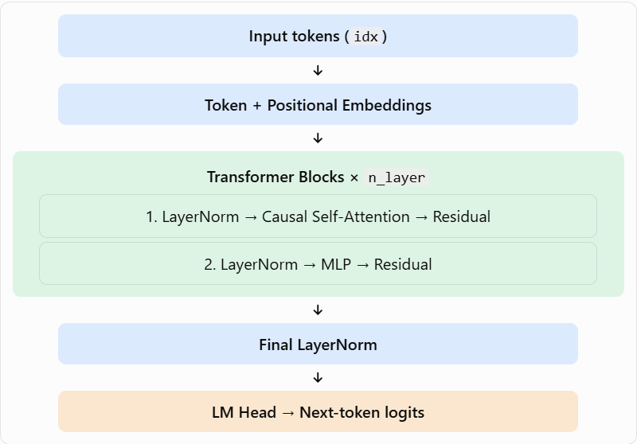

This code builds a GPT model from scratch using PyTorch. It learns to predict the next token (word or subword) from the tokens that came before it.

Let's understand it step by step in simple terms.

## 1. Overall architecture



Input tokens (`idx`)

Token + Positional Embeddings

Transformer Blocks × `n_layer`

1. LayerNorm → Causal Self-Attention → Residual

2. LayerNorm → MLP → Residual

Final LayerNorm

LM Head → Next-token logits

## 2. Step-by-step explanation

### Step 1: Custom LayerNorm

python
```
class LayerNorm(nn.Module):
    def __init__(self, ndim, bias):
```

- Normalizes the values in each token's feature vector.
- `weight` learns how much to scale values.
- `bias` optionally learns how much to shift values.
- `F.layer_norm()` performs the actual normalization.

Why? It helps stabilize training.

### Step 2: Causal Self-Attention

python
```
self.c_attn = nn.Linear(n_embd, 3 * n_embd)
```

This single linear layer produces three vectors for every token:

- Q (Query): What information am I looking for?
- K (Key): What information do I contain?
- V (Value): What information can I provide?

The code splits the output into Q, K and V.

python
```
att = (q @ k.transpose(-2, -1)) / math.sqrt(self.head_dim)
```

This calculates how strongly each token should attend to other tokens.

python
```
att = att.masked_fill(mask == 0, float("-inf"))
att = F.softmax(att, dim=-1)
```

The causal mask prevents a token from looking at future tokens.

For example, given `I love AI today`:

| Token | Tokens it can attend to |
| --- | --- |
| I | I |
| love | I, love |
| AI | I, love, AI |
| today | I, love, AI, today |

Why? The model must predict the next token without seeing the answer in advance.

### Step 3: Multi-head attention

python
```
self.n_head = config.n_head
self.head_dim = config.n_embd // config.n_head
```

Instead of learning one attention pattern, the model uses multiple heads.

For example, different heads may learn to focus on:

- Nearby words
- Subject–verb relationships
- Earlier references in a sentence

The heads are combined and passed through `c_proj`.

### Step 4: MLP (feed-forward network)

python
```
self.c_fc = nn.Linear(n_embd, 4 * n_embd)
self.c_proj = nn.Linear(4 * n_embd, n_embd)
```

The MLP processes each token's representation independently.

Its steps are:

1. Expand the feature dimension by 4×.
2. Apply the GELU activation.
3. Project back to the original dimension.
4. Apply dropout.

Why? Attention gathers information from other tokens; the MLP processes that information.

### Step 5: Transformer Block

python
```
x = x + self.attn(self.ln_1(x))
x = x + self.mlp(self.ln_2(x))
```

Each block contains two residual connections:

1. Normalize → attention → add the original input.
2. Normalize → MLP → add the previous result.

These are called pre-LayerNorm residual blocks.

Residual connections help information and gradients flow through deep networks.

### Step 6: Token and positional embeddings

python
```
tok_emb = self.transformer.wte(idx)
pos_emb = self.transformer.wpe(pos)
x = self.transformer.drop(tok_emb + pos_emb)
```

Two types of embeddings are added:

- Token embedding: Represents what each token is.
- Positional embedding: Represents where each token occurs.

For example, `dog bites man` and `man bites dog` contain the same words but have different meanings because their positions differ.

The model combines both embeddings before processing the sequence.

### Step 7: Stack transformer blocks

python
```
for block in self.transformer.h:
    x = block(x)
```

The output of one block becomes the input of the next.

As information passes through the blocks, token representations can capture increasingly complex relationships.

### Step 8: Predict the next token

python
```
x = self.transformer.ln_f(x)
logits = self.lm_head(x)
```

The final linear layer converts each token representation into scores for every token in the vocabulary.

These scores are called logits.

For example, the model might predict:

| Candidate token | Probability |
| --- | --- |
| today | 60% |
| tomorrow | 25% |
| yesterday | 15% |

These probabilities are illustrative. The model obtains them by applying softmax to the logits.

### Step 9: Calculate the training loss

python
```
loss = F.cross_entropy(
    logits.view(-1, logits.size(-1)),
    targets.view(-1),
    ignore_index=-1
)
```

The loss compares predicted token scores with the correct target tokens.

- Correct predictions generally produce lower loss.
- Incorrect predictions generally produce higher loss.
- `ignore_index=-1` excludes target positions marked `-1`.

During training, backpropagation and the optimizer adjust the model's parameters to reduce this loss.

### Step 10: Tie the input and output weights

python
```
self.transformer.wte.weight = self.lm_head.weight
```

The token embedding matrix is shared with the output projection.

Instead of maintaining two separate matrices, the model uses one shared matrix for both input token representations and output token scores.

Benefit: Fewer parameters and potentially better use of learned token representations.

### Step 11: Configure the optimizer

python
```
return torch.optim.AdamW(
    groups, lr=learning_rate, betas=betas
)
```

The code groups parameters into two categories:

- Weight decay: Parameters with two or more dimensions, such as weight matrices.
- No weight decay: One-dimensional parameters, such as biases and LayerNorm scales.

AdamW updates the model parameters during training.

### Step 12: Generate new tokens

python
```
logits, _ = self(idx_cond)
logits = logits[:, -1, :] / max(temperature, 1e-8)
probs = F.softmax(logits, dim=-1)
next_id = torch.multinomial(probs, num_samples=1)
```

Generation works autoregressively:

1. Take the current sequence.
2. Keep only the most recent `block_size` tokens if necessary.
3. Predict the next token.
4. Convert its logits into probabilities.
5. Sample a token.
6. Append it to the sequence.
7. Repeat until the requested number of tokens is generated or the end token is reached.

`temperature` controls randomness, while `top_k` restricts sampling to the highest-scoring candidates.

## 3. The key bug this implementation fixes

An ordinary bidirectional Transformer encoder can allow a token to access future tokens. That causes a problem when training a next-token language model: the model could see information it should be predicting.

This implementation uses a lower-triangular causal mask:

python
```
mask = torch.tril(torch.ones(block_size, block_size))
```

It ensures that position $i$ can attend only to positions $j \leq i$.

One important detail: causal attention prevents information from future input positions leaking into a prediction, but the training data must still construct `idx` and `targets` with the correct next-token shift.

## 4. Quick summary

| Component | Main purpose |
| --- | --- |
| Token embeddings | Represent token identities |
| Positional embeddings | Represent token positions |
| Causal self-attention | Gather information from past tokens |
| MLP | Process token features |
| LayerNorm | Stabilize activations |
| Residual connections | Help information and gradients flow |
| LM head | Produce vocabulary scores |
| Cross-entropy loss | Measure prediction errors |
| AdamW | Update model parameters |
| `generate()` | Predict tokens one by one |

In one sentence: This GPT converts tokens into vectors, repeatedly processes them using causal attention and MLPs, predicts the next token, and learns by comparing its predictions with the correct answers.