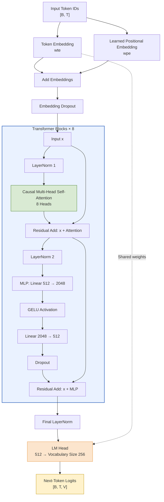

Here’s a Mermaid diagram showing only the NanoChat-X GPT model architecture, from input tokens through causal self-attention and transformer blocks to next-token prediction.

## Architecture at a glance

- Input embeddings: Token embeddings + learned positional embeddings.
- Transformer: 8 pre-LayerNorm blocks, each with 8-head causal self-attention and a 4× feed-forward MLP.
- Causal masking: Each token can attend only to itself and previous tokens.
- Output: Final LayerNorm → LM head → next-token logits.
- Weight tying: The LM head shares its weights with the token embedding.
- Configuration: 512 embedding dimensions, 256-token context window, vocabulary size 256.

Note: The diagram shows one transformer block in detail, repeated 8 times. The actual model predicts the next token during training by comparing its logits with the shifted target tokens.